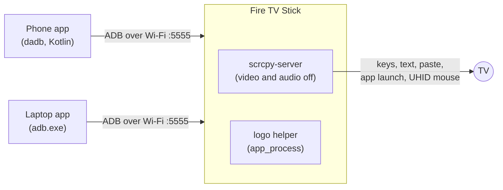

<h1 align="center">Fire Remote</h1>

<p align="center">
  <b>Use your phone or your Windows laptop as a fast Fire TV Stick remote, with a real mouse cursor.</b><br>
  It works over ADB on your own network, with no root, no cloud and no Amazon account.
</p>

<p align="center">
  <a href="../../releases/latest"></a>
  <a href="#what-you-need"></a>
  <a href="#what-you-need"></a>
  <a href="#first-on-the-tv"></a>
  <a href="LICENSE"></a>
</p>

<p align="center">
  <a href="#features"><b>Features</b></a> ·
  <a href="#what-you-need"><b>What you need</b></a> ·
  <a href="#first-on-the-tv"><b>First, on the TV</b></a> ·
  <a href="#phone-setup"><b>Phone setup</b></a> ·
  <a href="#laptop-setup"><b>Laptop setup</b></a> ·
  <a href="#troubleshooting"><b>Troubleshooting</b></a> ·
  <a href="#for-developers"><b>For developers</b></a>
</p>

Fire Remote talks to the Stick directly through Android's debugging bridge (ADB). It drives [scrcpy-server](https://github.com/Genymobile/scrcpy) on the TV with video turned off, so every key press arrives instantly. It can also plug a virtual mouse into the Stick, so websites and apps built for touch finally work with a cursor.

There are two apps, and you can use either or both:

| | Phone (`android/`) | Laptop (`desktop/`) |
|---|---|---|
| Runs on | Android 8.0+ | Windows 10/11 |
| Download | `FireRemote-Phone-<version>.apk` | `FireRemote.exe` |
| Needs | nothing else | the [scrcpy](https://github.com/Genymobile/scrcpy/releases) folder (for `adb.exe`) |

> [!NOTE]
> Fire Remote is an independent project. It is not made by, affiliated with or endorsed by Amazon. It sends the same input a remote, keyboard or mouse would. It doesn't root, modify or uninstall anything. The only things it leaves on the TV are a few small helper files in the temp folder (see [Undoing everything](#undoing-everything)).

---

## Features

### Instant remote
- **Instant keys.** The green dot means key presses go through scrcpy-server's control channel and land immediately. If that fails, the app falls back to plain `adb input` (amber dot), which works but is slower.
- **All the remote buttons.** D-pad, OK, Back, Home, Menu, play/pause, rewind and fast-forward. Holding a button repeats it (arrows, seek) or long-presses it (OK, Home for the quick menu, Back, Menu).
- **D-pad swipe** (phone). Slide anywhere on the D-pad to move, like the Amazon app. Longer slides move further, and resting your finger keeps it going.
- **Typing.** Anything you type or dictate on the phone shows up on the TV as you type, and Send presses Enter. On the laptop, press `T` to type or `Ctrl+V` to paste.

### A real mouse on the TV
- **Phone touchpad.** One finger moves the cursor and a tap clicks. Two fingers scroll, and a two-finger tap goes Back. You can change the speed and turn natural scrolling on or off.
- **Laptop mouse.** Click the Mouse button, or press `Ctrl+Alt+M` from any window. Then click the small scrcpy window, and your laptop's mouse drives the cursor on the TV. Alt gives the mouse back.
- **How it works.** Both apps plug a virtual USB mouse (UHID) into the Stick, so the TV draws its own real cursor, not a simulation.

### Your apps, with their real logos
- **Apps list.** See every app installed on the TV and launch any of them, including sideloaded ones.
- **Real logos.** The phone shows each app's own TV banner or icon. A small helper reads them on the TV, so nothing is downloaded from the internet.
- **Favorites row.** Pin up to 6 apps or websites. On the phone, the tiles stretch to fill the row.
- **Website tiles.** Open a site straight in [Sofa TV Browser](https://github.com/sonalder-darlene/sofa-tv-browser), for example YouTube on TV, a streaming site or a dashboard.

### Make the remote yours (phone)
- **Every button is configurable.** Give any button another action, such as Touchpad, Apps, Search, close the app on the TV or see the TV screen, or hide it entirely.
- **Sizes.** Adjust the button size and the whole interface size.
- **Look and language.** The theme follows the phone or is set to dark or light. Languages are English, French, Arabic (right-to-left), German and Spanish.
- **Phone volume buttons** control the TV while the app is open.

### Stays connected
- **Background connection** (phone). A foreground service keeps the connection open while you switch apps. Its notification has Play/pause, Back and Disconnect.
- **Reconnects by itself** after Wi-Fi drops, network changes or the Stick waking up. If the hotspot gives the Stick a new IP, both apps find it again.
- **Background timeout.** The phone disconnects after a time you choose (10 minutes by default) so it doesn't drain the battery.

### Extras
- **Screen peek** (phone). See what's on the TV as a still or live screenshot. Protected video such as Netflix shows black, as it does everywhere.
- **Close the TV app.** Force-closes whatever is in the foreground.
- **Power button.** Puts the Stick to sleep or wakes it. On TVs with HDMI-CEC, sleeping the Stick usually turns the TV off too.
- **Remote buttons.** Change what the Fire TV remote's own Netflix, Prime Video, YouTube, Disney+ and TV buttons do: Last app, Sleep, any app or a link. This needs the FireKeys companion app on the Stick, which isn't part of this repo.

### Laptop app

The laptop app has the same remote, plus:

- **Keyboard control** when its window has focus:

  | Key | Does |
  |---|---|
  | Arrows | D-pad |
  | Enter / Shift+Enter | OK / long-press OK |
  | Esc, Backspace | Back |
  | H / Shift+H | Home / quick menu |
  | M | Menu |
  | Space | Play / pause |
  | `[` `]` | Rewind / fast-forward |
  | `+` `-` | Volume (HDMI-CEC) |
  | Mouse wheel | Up / down |
  | T | Type on the TV |
  | Ctrl+V | Paste text to the TV |
  | Ctrl+Alt+M | TV mouse on / off, from any window |

- **More > Show the TV screen** opens scrcpy for full mirroring.
- **Apps menu.** Right-click an app to pin or unpin it. Right-click the favorites bar, or use More › Add website tile, to add a site.

---

## What you need

| | |
|---|---|
| **TV** | Any Fire TV Stick or Fire TV with Developer options (ADB debugging). |
| **Network** | The phone or laptop and the Stick on the same network. A Windows laptop's Mobile hotspot is the easiest, and it's what the default address `192.168.137.50` is for. A normal home Wi-Fi works too, as long as it doesn't block devices from talking to each other (many university and hotel networks do). |
| **Phone** | Android 8.0 or later. |
| **Laptop** | Windows 10/11, plus [scrcpy](https://github.com/Genymobile/scrcpy/releases) unzipped somewhere. |
| **Optional** | [Sofa TV Browser](https://github.com/sonalder-darlene/sofa-tv-browser) on the TV for website tiles. [Tailscale](https://tailscale.com) to reach the TV from another network. |

---

## First, on the TV

You only do this once.

1. **Unlock Developer options.** Go to **Settings › My Fire TV › About** and press OK on your device's name **7 times**, until it says you're a developer.
2. **Turn on ADB debugging.** Go to **Settings › My Fire TV › Developer options › ADB debugging** and turn it **on**.
3. **Note the TV's address.** Go to **Settings › My Fire TV › About › Network** and write down the **IP address**, for example `192.168.137.50`.

The first time each phone or laptop connects, the TV asks **"Allow USB debugging?"** Tick **Always allow from this computer**, then press **OK**.

---

## Phone setup

1. Download `FireRemote-Phone-<version>.apk` from [Releases](../../releases/latest) on the phone and open it.
2. Allow your browser or file manager to install apps when asked. If Play Protect warns you, choose **More details › Install anyway**, because the app isn't on the Play Store.
3. Put the phone on the same network as the Stick, for example the laptop's hotspot.
4. Open **Fire Remote**, tap the address at the top, and enter the TV's IP or use **Find the TV**.
5. Accept **Allow USB debugging?** on the TV, ticking *Always allow*.

You're connected when the dot turns green. From here:
- Star apps in **Apps** to add them to favorites, or use **+ › Add a website**.
- Long-press a tile to remove it.
- Settings are under the **⋮** menu › **Settings**.

## Laptop setup

1. Download [scrcpy](https://github.com/Genymobile/scrcpy/releases) (the `win64` zip) and unzip it, for example to `C:\scrcpy`.
2. Download `FireRemote.exe` from [Releases](../../releases/latest) and put it **in the scrcpy folder**, next to `adb.exe` and `scrcpy-server`.
3. Run it. Windows SmartScreen may warn about an unsigned app: choose **More info › Run anyway**.
4. Type the TV's IP and press **Connect**, or use **More (⋯) › Find the TV on my hotspot**.

The app finds `adb.exe` by itself, remembers the last TV, and keeps its settings in `%APPDATA%\FireRemote`.

### Using the laptop's hotspot

1. On Windows, go to **Settings › Network & internet › Mobile hotspot** and turn it **on**. Note the network name and password.
2. On the TV, go to **Settings › Network** and join that network.
3. Join it from the phone too if you use the phone app.

Windows gives hotspot devices addresses in `192.168.137.x`, which is why that's the default.

### Optional: control the TV from another network (Tailscale)

The phone can reach the Stick from anywhere, for example campus Wi-Fi or mobile data, while the Stick stays on the laptop's hotspot:

1. Install Tailscale on the laptop and the phone, and sign in to the same account on both.
2. On the laptop, share the hotspot's subnet: `tailscale up --advertise-routes=192.168.137.0/24`. Then approve the route in the Tailscale admin console.
3. On the phone, keep Tailscale on. Fire Remote then connects to `192.168.137.50` as if you were at home.

---

## Troubleshooting

| Problem | What to do |
|---|---|
| **Amber dot (basic mode)** | Instant mode couldn't start. Hover over the status on the laptop, or check the message on the phone, to see why. Keys still work, just slower. The mouse and touchpad need the green dot. |
| **"Can't reach the TV"** | Check that both devices are on the same network, and that the TV is awake and still has ADB debugging on. Try **Find the TV**. |
| **The TV never asks to allow** | Wake the TV and look for the dialog behind the current app. If you chose *Deny*, reconnect. On the phone you can also use **Settings › Reset this phone's ADB key**. |
| **Volume or turning the TV off doesn't work** | These go through HDMI-CEC, which some (especially older) TVs ignore. Turn on **Settings › Display & Sounds › HDMI CEC Device Control** on the Fire TV and CEC (Anynet+, Bravia Sync, SimpLink…) on the TV. Power always sleeps the Stick. |
| **Website tile does nothing** | Install [Sofa TV Browser](https://github.com/sonalder-darlene/sofa-tv-browser) on the TV. |
| **Screen peek is black** | That app protects its video (DRM). Nothing can capture it. |
| **"Ctrl+Alt+M is used by another app"** | Another program already took that shortcut. The Mouse button still works. |

## Undoing everything

- **TV.** Turn off **Developer options › ADB debugging**. To remove the small helper files the apps leave in the TV's temp folder, run:
  ```sh
  adb shell rm -f /data/local/tmp/fireremote-*
  ```
- **Phone.** Uninstall Fire Remote.
- **Laptop.** Delete `FireRemote.exe` and the `%APPDATA%\FireRemote` folder.

---

## How it works



1. **Connect.** The app connects to the Stick with ADB over TCP on port 5555. The laptop uses `adb.exe` from scrcpy. The phone has its own ADB client, [dadb](https://github.com/mobile-dev-inc/dadb), with its own key.
2. **Start the server.** It pushes `scrcpy-server` to `/data/local/tmp`, starts it with video and audio off, and opens its control socket.
3. **Send input.** Key events, text, clipboard paste and app launches are sent as scrcpy control messages. The mouse is a virtual UHID device, so the cursor is drawn by the TV itself.
4. **Read logos.** The phone runs a tiny Java helper on the TV with `app_process`. The helper reads each app's banner or icon through the TV's PackageManager and sends them back as PNGs.

If the server can't start, both apps fall back to `adb shell input`.

---

## For developers

### Repository layout

| Path | What |
|---|---|
| `desktop/FireRemote.cs`, `ButtonsDialog.cs` | Windows app (WinForms, .NET Framework 4.x, no NuGet packages) |
| `desktop/build.cmd` | Builds `FireRemote.exe` with the C# compiler that ships with Windows |
| `android/app/src/main/java/app/fireremote/phone/` | Phone app (Kotlin, Jetpack Compose, Material 3) |
| `android/app/src/test/` | Unit tests: scrcpy protocol encoding, button actions and logos, FireKeys commands, translations |
| `android/app/src/main/assets/` | `scrcpy-server` 5.0.1 (unmodified) and the logo helper `fireremote-icons.jar` |
| `android/tvhelper/` | Source and build script of the logo helper |

### Build the laptop app
Run `desktop\build.cmd`. You don't need Visual Studio.

### Build the phone app
You need JDK 17+ and the Android SDK (platform 36). Set `ANDROID_HOME`, or create `android/local.properties` with `sdk.dir=...`. Then:

```sh
cd android
./gradlew testReleaseUnitTest assembleRelease     # Windows: gradlew.bat ...
```

The APK lands in `android/app/build/outputs/apk/release/`.

**Signing.** Release builds read `android/keystore.properties`, which is gitignored:

```properties
storeFile=signing/my-release.jks
storePassword=...
keyAlias=...
keyPassword=...
```

Without that file, release builds are signed with your debug key.

> [!WARNING]
> The APK on the Releases page is signed with the author's key. Android won't install an APK signed with a different key over it, so uninstall the app first. Release APK certificate SHA-256:
> `3F:F2:4A:AA:8F:37:12:4A:DC:53:8E:C2:10:61:68:8C:36:F4:D6:07:47:A5:EE:1B:C9:A6:75:F0:BD:36:79:72`

### Rebuild the logo helper
```sh
ANDROID_HOME=/path/to/sdk sh android/tvhelper/build.sh
```

---

## Credits and license

Fire Remote is released under the [MIT license](LICENSE), © 2026 Oussama Lamaizi.

It builds on:
- [**scrcpy**](https://github.com/Genymobile/scrcpy) by Genymobile and Romain Vimont (Apache 2.0). Its server does the instant input and the virtual mouse.
- [**dadb**](https://github.com/mobile-dev-inc/dadb) by mobile.dev (Apache 2.0). It's the phone app's ADB client.

See [THIRD_PARTY_NOTICES.md](THIRD_PARTY_NOTICES.md) for the details.

Fire TV, Fire TV Stick and Amazon are trademarks of Amazon.com, Inc. or its affiliates.
